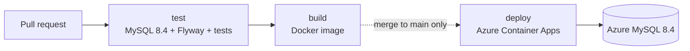
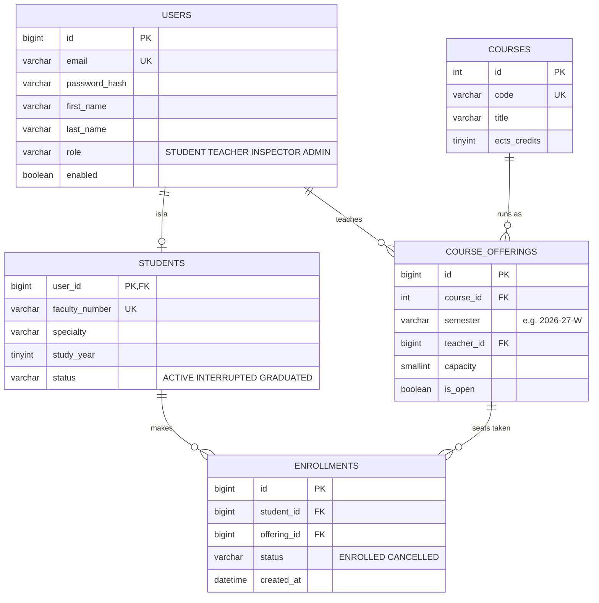

# UniCloud Portal

The Unified University Portal: accounts, academic profiles and course enrollment. It is also the single source of truth for who is who, which the other UniCloud teams read through its API.

**Stack:** Java 25 · Spring Boot 4.1 · MySQL 8.4 · Flyway · Docker · GitHub Actions · Azure Container Apps

**Production:** `https://<production-url>` (the exact address is in the "Live at" line of the latest deploy run in the **Actions** tab)

> Every merge to `main` reaches production within minutes. There is no staging environment, so merge only what you would show the Academic Council.

## Contents

1. [How it works](#how-it-works)
2. [What's in the repo](#whats-in-the-repo)
3. [Get set up](#get-set-up)
4. [Everyday workflow](#everyday-workflow)
5. [The pipeline](#the-pipeline)
6. [Changing the database](#changing-the-database)
7. [Rules the code must follow](#rules-the-code-must-follow)
8. [Checking and rolling back production](#checking-and-rolling-back-production)
9. [Load testing](#load-testing)
10. [Troubleshooting](#troubleshooting)

## How it works



- Every pull request runs `test` and `build`. Nothing is deployed.
- Every merge to `main` runs `test`, `build` and `deploy`. New replicas start before old ones stop, so the portal stays up during a deploy.
- Production runs 2 to 10 replicas behind Azure's load balancer and adds replicas as traffic grows.
- Only Flyway migrations create or change tables. Hibernate never does.

## What's in the repo

```text
.devcontainer/devcontainer.json   Codespaces setup: Java 25 and Docker
.github/workflows/deploy.yml      The pipeline: test, build, deploy
Dockerfile                        Builds the production image
infra/setup-azure.sh              One-time Azure setup (DevOps only)
loadtest/spike.js                 k6 test of the 08:00 enrollment rush
pom.xml, mvnw, .mvn/              Maven build
src/main/java/bg/tusofia/unicloud/portal/
    PortalApplication.java        Spring Boot entry point
    HealthController.java         /health and /  (keep them, see Rules)
    ServedByFilter.java           X-Served-By header (keep it)
    Replica.java                  Replica name for the two above
src/main/resources/
    application.properties        Settings; production values come from environment variables
    db/migration/                 Flyway migrations: V1__init_schema.sql, then V2__..., V3__...
src/test/java/                    Tests, run against MySQL 8.4 in the pipeline
```

## Get set up

### Option A: GitHub Codespaces (recommended)

1. On the repo page, click **Code → Codespaces → Create codespace on main**. The first start takes a few minutes while it installs Java 25 and Docker.
2. In the terminal, start a local MySQL 8.4:

   ```bash
   docker run --name unicloud-mysql -d -p 3306:3306 \
     -e MYSQL_ROOT_PASSWORD=dev -e MYSQL_DATABASE=unicloud mysql:8.4
   ```

3. Wait about 20 seconds for MySQL to come up, then start the app:

   ```bash
   ./mvnw spring-boot:run
   ```

4. Codespaces offers to open port 8080 in the browser. You should see JSON with `"service":"unicloud-portal"`, and Flyway has created the tables in your local database.

### Option B: your own computer

Install JDK 25 (Eclipse Temurin), Docker and Git, then clone the repo and follow steps 2 to 4 above. The app runs at http://localhost:8080.

```bash
git clone https://github.com/rata5/unicloud-portal.git
cd unicloud-portal
```

### Local commands

| Task | Command |
| --- | --- |
| Run all tests (the local MySQL must be running) | `./mvnw verify` |
| Start the app | `./mvnw spring-boot:run` |
| Stop or start the local database | `docker stop unicloud-mysql`, `docker start unicloud-mysql` |
| Wipe the local database and start fresh | `docker rm -f unicloud-mysql`, then the `docker run` command again |
| Open a SQL prompt | `docker exec -it unicloud-mysql mysql -uroot -pdev unicloud` |

The app reads its database address from `DATABASE_URL`. When that isn't set, it uses the local MySQL above, so you never need production credentials.

## Everyday workflow

`main` is protected: nobody can push to it directly, and every change goes through a pull request whose `test` and `build` checks must pass.

1. Start a branch from the latest `main`:

   ```bash
   git switch main && git pull
   git switch -c feature/short-description
   ```

2. Make your change and run `./mvnw verify`.
3. Commit and push the branch:

   ```bash
   git add .
   git commit -m "Short summary of the change"
   git push -u origin feature/short-description
   ```

4. Open a pull request on GitHub. Wait for green `test` and `build` checks and a teammate's approval.
5. Click **Squash and merge**, then delete the branch.
6. Watch the deploy in the **Actions** tab. When it's green, `/health` on production reports your commit.

## The pipeline

It's defined in `.github/workflows/deploy.yml`.

| Job | Runs on | What it does | Typical time |
| --- | --- | --- | --- |
| `test` | Every pull request and merge | Starts MySQL 8.4, lets Flyway apply every migration, runs `./mvnw verify` | About 2 min |
| `build` | Every pull request and merge | Builds the Docker image; on `main` it also pushes it to GHCR, tagged with the commit SHA | About 3 min |
| `deploy` | Merges to `main` only | Deploys the image to Azure Container Apps and waits until `/health` shows the new commit | 2 to 4 min |

A red job stops everything after it, so a failing test never reaches production. Click the failed job to read its log, fix the problem and push to the same branch again.

A failed `deploy` is usually an Azure problem rather than your code: send the run's link to the team's DevOps engineer.

The pipeline's secrets (`AZURE_*`, `DATABASE_URL`, `GHCR_PAT`) are managed by DevOps under **Settings → Secrets and variables → Actions**. You don't need them, and credentials must never appear in code.

## Changing the database

The schema is in third normal form:



To change it:

1. Add a new file in `src/main/resources/db/migration`, numbered after the last one: `V2__add_course_description.sql`, then `V3__...`. Note the two underscores after the number.
2. Never edit a migration that has already run anywhere, `V1` included. Flyway keeps a checksum of every file and refuses to start if one changes.
3. Run `./mvnw verify`. Flyway applies your new file to the local MySQL first, so SQL errors show up immediately.
4. Open a pull request as usual. The pipeline applies every migration to a fresh MySQL 8.4, and the next deploy applies the new ones to Azure.

Keep each change backwards-compatible, because old and new replicas run side by side for a minute during every deploy. To rename or remove a column, add the new column in one release, switch the code over, and drop the old column in a later release.

JPA entities must match the tables. `spring.jpa.hibernate.ddl-auto=validate` stops the app at startup if an entity and its table disagree.

## Rules the code must follow

The pipeline and the 08:00 enrollment rush depend on these:

- **Keep `/health` and `/` in `HealthController`.** The deploy waits until `/health` returns the new commit SHA. `/` and the `X-Served-By` header show which replica answered. `/health` must never query the database.
- **Listen on port 8080 and keep graceful shutdown on**, so deploys and scale-in drop no requests.
- **Keep the connection pool at 15 or fewer** (`spring.datasource.hikari.maximum-pool-size`). The database allows 171 connections in total, shared by up to 10 replicas.
- **Let only active students enroll.** Check that `students.status` is `ACTIVE` before taking a seat.
- **Take a seat in one transaction, behind a lock.** Otherwise two students can both get the last seat at 08:00:

```java
@Transactional
public void enroll(long studentId, long offeringId) {
    // Locks this offering's row: other enrollments in the same course wait their turn
    Integer capacity = jdbc.query(
            "SELECT capacity FROM course_offerings WHERE id = ? AND is_open FOR UPDATE",
            rs -> rs.next() ? rs.getInt(1) : null, offeringId);
    if (capacity == null) {
        throw new IllegalStateException("Course is closed");
    }
    // A locking read always sees the latest committed enrollments
    Integer taken = jdbc.queryForObject(
            "SELECT COUNT(*) FROM enrollments WHERE offering_id = ? AND status = 'ENROLLED' FOR SHARE",
            Integer.class, offeringId);
    if (taken >= capacity) {
        throw new IllegalStateException("Course is full");
    }
    jdbc.update("INSERT INTO enrollments (student_id, offering_id) VALUES (?, ?)", studentId, offeringId);
}
```

Here `jdbc` is a `JdbcTemplate`. A `DuplicateKeyException` from the insert means a row already exists: if its status is `CANCELLED`, update it back to `ENROLLED`; otherwise the student is already enrolled. Cancelling takes the same row lock first, then sets the status to `CANCELLED`.

## Checking and rolling back production

- **Which version is live:** open `https://<production-url>/health`. `version` is the commit SHA of the running code.
- **Which replica answered:** the `X-Served-By` response header, or the JSON at `/`.
- **Logs and metrics:** in the Azure portal, under the Container App `unicloud-portal` (**Monitoring → Log stream** and **Metrics**). Ask DevOps for Reader access.
- **Roll back:** open the merged pull request on GitHub, click **Revert**, and merge the revert pull request. The pipeline deploys the previous code like any other change.

If production is down and that is too slow, DevOps can redeploy an earlier image directly:

```bash
az containerapp update -n unicloud-portal -g unicloud-rg \
  --image ghcr.io/rata5/unicloud-portal:<previous-commit-sha>
```

Reverting code doesn't undo a migration that has already run. If a migration was the problem, fix the schema with a new migration.

## Load testing

`loadtest/spike.js` simulates the 08:00 rush: it ramps from 10 to 500 users in 30 seconds and holds them for 2 minutes. It passes only if at least 99.5% of requests succeed and 95% answer within 1 second.

```bash
k6 run -e BASE_URL=https://<production-url> loadtest/spike.js
```

Check with DevOps before running it against production. Each run spends the database's CPU credits, and there are no load tests in the 24 hours before enrollment opens. To test new endpoints, edit the `default` function in `spike.js`.

## Troubleshooting

| Problem | Fix |
| --- | --- |
| Push rejected because `main` is a protected branch | Push to a branch and open a pull request |
| `test` fails with a Flyway or SQL error | Your migration doesn't run on MySQL 8.4. Reproduce it with `./mvnw verify` against the local MySQL |
| `test` fails with `Schema-validation: missing column` or `missing table` | An entity doesn't match the tables. Add a migration or fix the entity |
| App won't start: `Migration checksum mismatch` | An applied migration was edited. Undo the edit and put the change in a new `V...` file |
| Locally: `Communications link failure` | The local MySQL isn't running. Run `docker start unicloud-mysql` and wait 20 seconds |
| Locally: port 3306 is already in use | Another MySQL is running. Stop it, or run the container with `-p 3307:3306` and set `DATABASE_URL=jdbc:mysql://localhost:3307/unicloud?user=root&password=dev&sslMode=REQUIRED` |
| `deploy` fails | Usually Azure, not your code. Send the run's link to DevOps |
