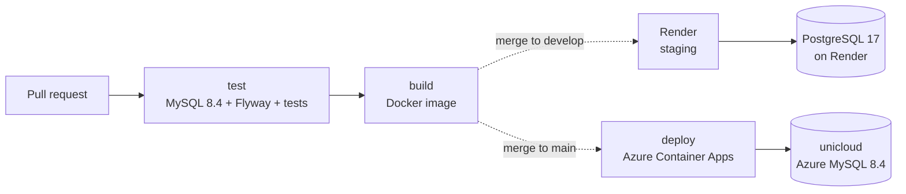
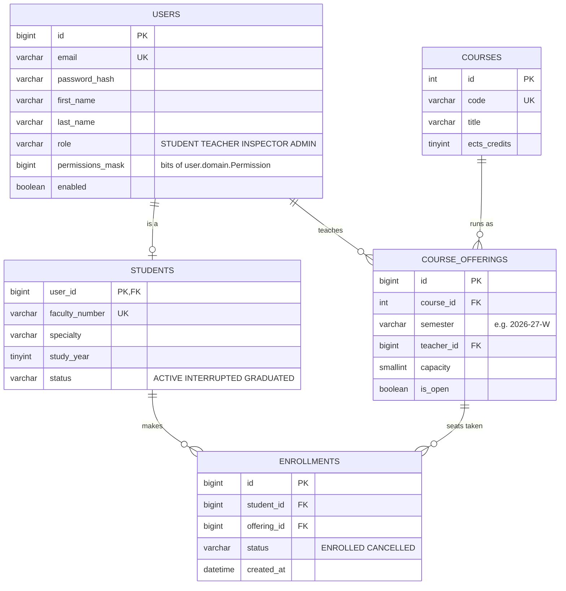

# UniCloud Portal

The Unified University Portal: accounts, academic profiles and course enrollment. It is also the single source of truth for who is who, which the other UniCloud teams read through its API.

**Stack:** Java 25 · Spring Boot 4.1 · MySQL 8.4 (production) · PostgreSQL 17 (staging) · Flyway · Docker · GitHub Actions · Azure Container Apps (production) · Render (staging)

**Production (Azure):** `https://<production-url>` (the exact address is in the "Live at" line of the latest deploy run in the **Actions** tab)

**Staging (Render):** `https://<staging-url>` (the address is at the top of the `unicloud-portal-staging` service in the Render dashboard)

> Every merge to `develop` goes to staging, and every merge to `main` reaches production within minutes. Try every change on staging first, and merge into `main` only what you would show the Academic Council.

## Contents

1. [How it works](#how-it-works)
2. [Environments](#environments)
3. [What's in the repo](#whats-in-the-repo)
4. [Get set up](#get-set-up)
5. [Everyday workflow](#everyday-workflow)
6. [The pipeline](#the-pipeline)
7. [Changing the database](#changing-the-database)
8. [Rules the code must follow](#rules-the-code-must-follow)
9. [Checking and rolling back production](#checking-and-rolling-back-production)
10. [Load testing](#load-testing)
11. [Troubleshooting](#troubleshooting)

## How it works



- Every pull request runs `test` and `build`. Nothing is deployed.
- Every merge to `develop` runs `test`, `test-postgres` and `build`. Once all of them pass, Render rebuilds the app from `develop` and deploys it to staging.
- Every merge to `main` runs `test`, `build` and `deploy`. New replicas start before old ones stop, so the portal stays up during a deploy.
- Production runs 2 to 10 replicas behind Azure's load balancer and adds replicas as traffic grows.
- Only Flyway migrations create or change tables. Hibernate never does.
- Every environment describes its own API: Swagger UI at `/swagger-ui.html`, and the OpenAPI JSON at `/v3/api-docs`, which other UniCloud teams can generate clients from. Both open without a token; calling an endpoint from Swagger UI still needs one (log in with `POST /api/v1/auth/login`, then paste `accessToken` under **Authorize**).

## Environments

| | Staging | Production |
| --- | --- | --- |
| Branch | `develop` | `main` |
| Runs on | Render, free web service, Frankfurt | Azure Container Apps, Frankfurt, 2 to 10 replicas |
| Database | PostgreSQL 17, Render's free database in Frankfurt | MySQL 8.4 on Azure (`unicloud`) |
| Migrations | `db/migration-postgresql` | `db/migration` |
| Login keys | Staging's own JWT key pair, set in Render | Production's pair, in the GitHub secrets |
| Deployed by | Render, once every check passes on `develop` | The `deploy` job, on every merge to `main` |
| Data | Test data only | Real data |

Both databases get the same tables from Flyway: production from the MySQL files in `db/migration`, staging from their PostgreSQL copies in `db/migration-postgresql`. Staging applies a new migration when it reaches `develop`, production when it reaches `main`. Staging's database lives on Render, apart from production's, so nothing on staging can change production data.

Staging sleeps after 15 minutes without visitors, so the first page after a quiet spell can take 1 to 3 minutes. Render deletes its free database 30 days after it's created, so DevOps replaces staging's database each month; Flyway rebuilds the tables and the test data on the next start. Never copy production data into staging.

## What's in the repo

```text
.devcontainer/devcontainer.json   Codespaces setup: Java 25 and Docker
.github/workflows/deploy.yml      The pipeline: test, build, deploy
Dockerfile                        Builds the production image
infra/setup-azure.sh              One-time Azure setup (DevOps only)
loadtest/spike.js                 k6 test of the 08:00 enrollment rush
pom.xml, mvnw, .mvn/              Maven build
src/main/java/bg/tusofia/unicloud/portal/
    PortalApplication.java        Spring Boot entry point
    HealthController.java         /health and /  (keep them, see Rules)
    ServedByFilter.java           X-Served-By header (keep it)
    Replica.java                  Replica name for the two above
src/main/resources/
    application.properties        Settings; production values come from environment variables
    db/migration/                 Flyway migrations for MySQL: V1__init_schema.sql, then V2__..., V3__...
    db/migration-postgresql/      The same migrations for PostgreSQL, used by staging
src/test/java/                    Tests, run against MySQL 8.4 in the pipeline
```

## Get set up

### Option A: GitHub Codespaces (recommended)

1. On the repo page, click **Code → Codespaces → Create codespace on develop**. The first start takes a few minutes while it installs Java 25 and Docker.
2. In the terminal, start a local MySQL 8.4:

   ```bash
   docker run --name unicloud-mysql -d -p 3306:3306 \
     -e MYSQL_ROOT_PASSWORD=dev -e MYSQL_DATABASE=unicloud mysql:8.4
   ```

3. Create the key pair the app signs login tokens with. It lives in `secrets/`, which git ignores, so every checkout makes its own (once):

   ```bash
   mkdir -p secrets
   openssl genpkey -algorithm RSA -pkeyopt rsa_keygen_bits:2048 -out secrets/private.pem
   openssl pkey -in secrets/private.pem -pubout -out secrets/public.pem
   ```

4. Wait about 20 seconds for MySQL to come up, then start the app:

   ```bash
   ./mvnw spring-boot:run
   ```

5. Codespaces offers to open port 8080 in the browser. You should see JSON with `"service":"unicloud-portal"`, and Flyway has created the tables in your local database.

### Option B: your own computer

Install JDK 25 (Eclipse Temurin), Docker and Git, then clone the repo and follow steps 2 to 5 above. The app runs at http://localhost:8080.

```bash
git clone https://github.com/rata5/unicloud-portal.git
cd unicloud-portal
```

### Local commands

| Task | Command |
| --- | --- |
| Run all tests (the local MySQL must be running; the tests make their own JWT keys) | `./mvnw verify` |
| Start the app | `./mvnw spring-boot:run` |
| Browse and try the API | http://localhost:8080/swagger-ui.html (the app must be running) |
| Stop or start the local database | `docker stop unicloud-mysql`, `docker start unicloud-mysql` |
| Wipe the local database and start fresh | `docker rm -f unicloud-mysql`, then the `docker run` command again |
| Open a SQL prompt | `docker exec -it unicloud-mysql mysql -uroot -pdev unicloud` |

The app reads its database address from `DATABASE_URL`. When that isn't set, it uses the local MySQL above, so you never need production credentials.

## Everyday workflow

`develop` and `main` are protected: nobody can push to them directly, and every change goes through a pull request whose `test` and `build` checks must pass.

1. Start a branch from the latest `develop`:

   ```bash
   git switch develop && git pull
   git switch -c feature/short-description
   ```

2. Make your change and run `./mvnw verify`.
3. Commit and push the branch:

   ```bash
   git add .
   git commit -m "Short summary of the change"
   git push -u origin feature/short-description
   ```

4. Open a pull request into `develop`, which GitHub picks by default. Wait for green `test` and `build` checks and a teammate's approval.
5. Click **Squash and merge**, then delete the branch.
6. A few minutes later, Render deploys it to staging. Try your change there before it goes any further.

### Releasing to production

DevOps moves what's on staging to production:

1. Open a pull request from `develop` into `main`, titled `Release <date>`.
2. Wait for green `test` and `build` checks and a teammate's approval.
3. Merge it with **Create a merge commit**. Don't squash: squashing makes `main` and `develop` drift apart, and the next release then shows old changes as conflicts.
4. Watch the deploy in the **Actions** tab. When it's green, `/health` on production reports the release's commit.

An urgent production fix goes the other way: branch from `main` and open the pull request into `main`. Afterwards, open a pull request from `main` into `develop` and merge it with **Create a merge commit**, so staging gets the fix too. Do the same after reverting a release on `main` (see [Checking and rolling back production](#checking-and-rolling-back-production)).

## The pipeline

It's defined in `.github/workflows/deploy.yml`.

| Job | Runs on | What it does | Typical time |
| --- | --- | --- | --- |
| `test` | Every pull request, and every merge to `develop` or `main` | Starts MySQL 8.4, lets Flyway apply every migration, runs `./mvnw verify` | About 2 min |
| `test-postgres` | Every pull request, and every merge to `develop` or `main` | Runs the same tests on PostgreSQL 17 with the migrations in `db/migration-postgresql`, as staging does. Production's deploy doesn't wait for it | About 2 min |
| `build` | Every pull request, and every merge to `develop` or `main` | Builds the Docker image; on `main` it also pushes it to GHCR, tagged with the commit SHA | About 3 min |
| `deploy` | Merges to `main` only | Deploys the image to Azure Container Apps and waits until `/health` shows the new commit | 2 to 4 min |

A red job stops everything after it, so a failing test never reaches production. Staging isn't deployed by this workflow: Render watches `develop` and deploys a commit only once all its checks pass, so a failing test never reaches staging either. Click the failed job to read its log, fix the problem and push to the same branch again.

A failed `deploy` is usually an Azure problem rather than your code: send the run's link to the team's DevOps engineer.

The pipeline's secrets (`AZURE_*`, `DATABASE_URL`, `GHCR_PAT`, `JWT_PRIVATE_KEY`, `JWT_PUBLIC_KEY`) are managed by DevOps under **Settings → Secrets and variables → Actions**. You don't need them, and credentials must never appear in code.

`JWT_PRIVATE_KEY` and `JWT_PUBLIC_KEY` hold the PEM text of the key pair production signs login tokens with (the deploy passes them to the app as Container App secrets). Create it once with the `openssl` commands from "Get set up", paste each file's full contents into its secret, and keep the private key nowhere else. Rotating the pair logs every user out, so do it between semesters.

Staging has its own settings, kept in Render on the `unicloud-portal-staging` service's **Environment** page: its `DATABASE_URL` (Render's PostgreSQL database), `SPRING_FLYWAY_LOCATIONS=classpath:db/migration-postgresql`, and its own key pair in `APP_JWT_PRIVATE_KEY` and `APP_JWT_PUBLIC_KEY`. Never reuse production's values there.

## Changing the database

The schema is in third normal form:



To change it:

1. Add a new file in `src/main/resources/db/migration`, numbered after the last one: `V4__add_course_description.sql`, then `V5__...`. Note the two underscores after the number.
2. Add its PostgreSQL copy, with the same file name, in `src/main/resources/db/migration-postgresql`. The header of `V1__init_schema.sql` there shows how the MySQL types map.
3. Never edit a migration that has already run anywhere, `V1` included. Flyway keeps a checksum of every file and refuses to start if one changes.
4. Run `./mvnw verify`. Flyway applies your new file to the local MySQL first, so SQL errors show up immediately.
5. Open a pull request as usual. The pipeline applies every migration to a fresh MySQL 8.4 (`test`) and every PostgreSQL copy to a fresh PostgreSQL 17 (`test-postgres`). After the merge, staging applies the new ones to its database, and the next release applies them to production's.

Keep each change backwards-compatible, because old and new replicas run side by side for a minute during every deploy. To rename or remove a column, add the new column in one release, switch the code over, and drop the old column in a later release.

JPA entities must match the tables. `spring.jpa.hibernate.ddl-auto=validate` stops the app at startup if an entity and its table disagree.

## Rules the code must follow

The pipeline and the 08:00 enrollment rush depend on these:

- **Keep `/health` and `/` in `HealthController`.** The deploy waits until `/health` returns the new commit SHA. `/` and the `X-Served-By` header show which replica answered. `/health` must never query the database.
- **Listen on port 8080 and keep graceful shutdown on**, so deploys and scale-in drop no requests.
- **Keep the connection pool at 15 or fewer** (`spring.datasource.hikari.maximum-pool-size`). The database allows 171 connections in total, shared by up to 10 replicas.
- **Let only active students enroll.** Check that `students.status` is `ACTIVE` before taking a seat.
- **Take a seat in one transaction, behind a lock.** Otherwise two students can both get the last seat at 08:00:

```java
@Transactional
public void enroll(long studentId, long offeringId) {
    // Locks this offering's row: other enrollments in the same course wait their turn
    Integer capacity = jdbc.query(
            "SELECT capacity FROM course_offerings WHERE id = ? AND is_open FOR UPDATE",
            rs -> rs.next() ? rs.getInt(1) : null, offeringId);
    if (capacity == null) {
        throw new IllegalStateException("Course is closed");
    }
    // A locking read always sees the latest committed enrollments
    Integer taken = jdbc.queryForObject(
            "SELECT COUNT(*) FROM enrollments WHERE offering_id = ? AND status = 'ENROLLED' FOR SHARE",
            Integer.class, offeringId);
    if (taken >= capacity) {
        throw new IllegalStateException("Course is full");
    }
    jdbc.update("INSERT INTO enrollments (student_id, offering_id) VALUES (?, ?)", studentId, offeringId);
}
```

Here `jdbc` is a `JdbcTemplate`. A `DuplicateKeyException` from the insert means a row already exists: if its status is `CANCELLED`, update it back to `ENROLLED`; otherwise the student is already enrolled. Cancelling takes the same row lock first, then sets the status to `CANCELLED`.

## Checking and rolling back production

- **Which version is live:** open `https://<production-url>/health`. `version` is the commit SHA of the running code.
- **Which replica answered:** the `X-Served-By` response header, or the JSON at `/`.
- **Logs and metrics:** in the Azure portal, under the Container App `unicloud-portal` (**Monitoring → Log stream** and **Metrics**). Ask DevOps for Reader access.
- **Roll back:** open the merged pull request on GitHub, click **Revert**, and merge the revert pull request. The pipeline deploys the previous code like any other change.

If production is down and that is too slow, DevOps can redeploy an earlier image directly:

```bash
az containerapp update -n unicloud-portal -g unicloud-rg \
  --image ghcr.io/rata5/unicloud-portal:<previous-commit-sha>
```

Reverting code doesn't undo a migration that has already run. If a migration was the problem, fix the schema with a new migration.

## Load testing

`loadtest/spike.js` simulates the 08:00 rush: it ramps from 10 to 500 users in 30 seconds and holds them for 2 minutes. It passes only if at least 99.5% of requests succeed and 95% answer within 1 second.

```bash
k6 run -e BASE_URL=https://<production-url> loadtest/spike.js
```

Check with DevOps before running it against production. Each run spends the database's CPU credits, and there are no load tests in the 24 hours before enrollment opens. Don't run it against staging: its free Render instance is far smaller than production, so the results would say nothing about the 08:00 rush. To test new endpoints, edit the `default` function in `spike.js`.

## Troubleshooting

| Problem | Fix |
| --- | --- |
| Push rejected because `develop` or `main` is a protected branch | Push to a branch and open a pull request |
| `test` fails with a Flyway or SQL error | Your migration doesn't run on MySQL 8.4. Reproduce it with `./mvnw verify` against the local MySQL |
| `test` fails with `Schema-validation: missing column` or `missing table` | An entity doesn't match the tables. Add a migration or fix the entity |
| App won't start: `Migration checksum mismatch` | An applied migration was edited. Undo the edit and put the change in a new `V...` file |
| Locally: `Communications link failure` | The local MySQL isn't running. Run `docker start unicloud-mysql` and wait 20 seconds |
| Locally: app won't start, `secrets/private.pem` or `secrets/public.pem` not found | Create the JWT key pair (step 3 of "Get set up") |
| Locally: port 3306 is already in use | Another MySQL is running. Stop it, or run the container with `-p 3307:3306` and set `DATABASE_URL=jdbc:mysql://localhost:3307/unicloud?user=root&password=dev&sslMode=REQUIRED` |
| `deploy` fails | Usually Azure, not your code. Send the run's link to DevOps |
| Staging takes a minute or more to load | It was asleep: the free service sleeps after 15 minutes without visitors. Wait a minute and reload |
| `test-postgres` fails but `test` passes | The PostgreSQL copy of a migration is missing or different. Fix it in `db/migration-postgresql` |
| Your change isn't on staging a few minutes after the merge | Render deploys only once every check passes on `develop`. Check the run in the **Actions** tab, then ask DevOps |
