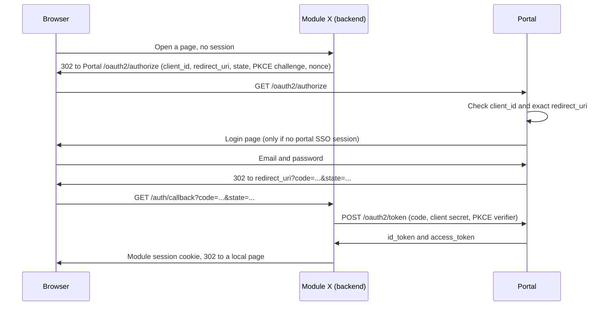

# Single sign-on through the portal

The other UniCloud modules log users in through the portal. A user signs in once, at the portal, and every module trusts that sign-in.

The portal is a standard **OpenID Connect** provider. It uses the **OAuth 2.0 authorization code flow with PKCE**. Every module can use an existing OIDC client library in its own language. Nothing here is specific to UniCloud except the user claims.

**Module teams:** sections 1 to 10 are for you. Start with [Testing a module against staging](#testing-a-module-against-staging) to log in from your own machine today. Sections 11 to 13 are for the portal team.

## Contents

1. [The rules in short](#the-rules-in-short)
2. [Callback URLs per environment](#callback-urls-per-environment)
3. [The flow](#the-flow)
4. [Endpoints](#endpoints)
5. [What a module must build](#what-a-module-must-build)
6. [User claims](#user-claims)
7. [Logout](#logout)
8. [Testing a module against staging](#testing-a-module-against-staging)
9. [Going to production](#going-to-production)
10. [Troubleshooting](#troubleshooting)
11. [Registering a module (portal admins)](#registering-a-module-portal-admins)
12. [How the portal does it](#how-the-portal-does-it)
13. [Not done yet](#not-done-yet)

## The rules in short

- A module sends the browser to the portal's `/oauth2/authorize` with a `redirect_uri` (the "callback"). The portal sends the user back to it after login.
- In production every callback URL is registered in advance, on a host the portal allows. The portal refuses any other URL and does not redirect to it. A matching host or prefix is not enough: the whole URL must match, character for character. Staging accepts any callback (see [Callback URLs per environment](#callback-urls-per-environment)).
- The callback **never** receives user data or a token. It receives a short-lived, single-use `code`.
- The module's backend exchanges that code for the user's identity by calling the portal directly, server to server.

Why: anything put in a redirect URL ends up in browser history, server logs and `Referer` headers. A callback URL that is not checked lets an attacker send a victim to the login page with their own callback and receive the victim's identity.

## Callback URLs per environment

The callbacks are the `redirect_uri` of a login and the `post_logout_redirect_uri` of a logout.

| Environment | Which callbacks work | Set by |
|---|---|---|
| **Production** | Only URLs registered for the module, matched exactly, `https`, on a host listed in [`sso-callback-hosts.properties`](../src/main/resources/sso-callback-hosts.properties) | The default (`app.sso.callback-policy=allowlist`) |
| **Staging** | Any absolute `http` or `https` URL, registered or not, including `http://localhost` on a developer's machine | The `staging` profile (`SPRING_PROFILES_ACTIVE=staging` in Render) |

**The production host list.** `src/main/resources/sso-callback-hosts.properties` holds one comma-separated list. An entry is an exact host (`library.tu-sofia.bg`) or every subdomain of a domain (`*.tu-sofia.bg`, which does not include `tu-sofia.bg` itself). Change it with a pull request.
- A module can register in production only once its host is on the list.
- Taking a host off the list switches off the logins and logouts of every module that uses it, at the next deploy, even if the module stays registered.
- In an emergency, the variable `APP_SSO_ALLOWED_CALLBACK_HOSTS` overrides the whole list without a release.
- The list is empty today, because no module is live yet.

Even staging accepts only `http` and `https` URLs. A `javascript:` or relative URL is refused everywhere.

## The flow



If the user already has a portal SSO session, step 4 is skipped: the portal sends the code straight back. The session ends after 30 minutes without use, 8 hours after the user typed the password however busy it is, or when the user logs out of the portal.

## Endpoints

`<portal>` is the portal's public address, for example `https://portal.example`. A library that reads the discovery document needs only that address.

| Endpoint | Purpose |
|---|---|
| `GET /.well-known/openid-configuration` | The discovery document. It lists every endpoint below. |
| `GET /oauth2/authorize` | Starts a login. The browser goes here. |
| `POST /oauth2/token` | Exchanges a code for tokens. The module's backend calls it. |
| `GET /oauth2/jwks` | The public keys that sign the tokens, each with a `kid`. |
| `GET /userinfo` | The user's claims, for a module's access token. |
| `GET /connect/logout` | Ends the portal's SSO session. See [Logout](#logout). |

## What a module must build

The modules are server-side apps. Each one is a **confidential client**: it holds a client secret on its server.

### Start the login

Before redirecting to the portal, the module:

1. Makes a random `state`, a random `nonce` and a random PKCE `code_verifier` (43 to 128 characters from `A-Z a-z 0-9 - . _ ~`).
2. Stores all three in the user's session on the module's side.
3. Redirects the browser to:

```
GET <portal>/oauth2/authorize
    ?response_type=code
    &client_id=<client_id>
    &redirect_uri=<a registered callback URL>
    &scope=openid profile email unicloud
    &state=<state>
    &nonce=<nonce>
    &code_challenge=<BASE64URL(SHA256(code_verifier))>
    &code_challenge_method=S256
```

`scope` decides which user claims the module receives (see [User claims](#user-claims)). Ask only for what the module needs. `openid` is always required.

PKCE is required. Without `code_challenge` the portal answers the callback with `error=invalid_request`.

### The callback endpoint

The callback must accept exactly these two forms:

```
GET <registered redirect_uri>?code=<opaque string>&state=<the state the module sent>
GET <registered redirect_uri>?error=<access_denied|invalid_request|invalid_scope|...>&error_description=<text>&state=<the state the module sent>
```

The handler must:

1. Compare `state` with the value stored in the session. If they differ, reject the request. This stops login CSRF, where an attacker logs the victim into the attacker's account.
2. On `error`, show a message. Do not loop back to the portal automatically.
3. On `code`, exchange it as described below.
4. Validate the `id_token` (see below).
5. Create the module's **own** session, as a cookie with `HttpOnly; Secure; SameSite=Lax`.
6. Redirect the user to a **local path** only. If the module remembers a "return to" page, it must be a relative path that the module stored itself. It must never be an absolute URL taken from the query string.

### Exchanging the code

The module's backend makes a normal HTTPS request to the portal. The browser takes no part in it.

```
POST <portal>/oauth2/token
Authorization: Basic base64(<client_id>:<client_secret>)
Content-Type: application/x-www-form-urlencoded

grant_type=authorization_code
&code=<code from the callback>
&redirect_uri=<the same redirect_uri as in the login>
&code_verifier=<the PKCE code_verifier>
```

Response:

```json
{
  "access_token": "<JWT>",
  "id_token": "<JWT>",
  "scope": "openid profile email unicloud",
  "token_type": "Bearer",
  "expires_in": 1799
}
```

There is no refresh token. When the module's own session ends, it sends the user through the login again. If the portal's SSO session is still alive, that takes no password.

The endpoint is public, and that is safe. No single value in the request is enough to get a token:

| Value | What it proves |
|---|---|
| `client_secret` | The caller is the module's server. Only that server has the secret. |
| `code` | A user just logged in for this module. The code is single use and expires after 60 seconds. |
| `redirect_uri` | The code is used where it was issued for. |
| `code_verifier` | The caller is the party that started this login. It must hash to the `code_challenge`. |

An attacker who sees a code, in browser history or a log for example, has neither the secret nor the verifier. They cannot exchange it.

A code is exchanged once. A second exchange fails with `invalid_grant`, and the portal also **revokes the tokens the first exchange gave**, because one of the two callers was not the module. This holds even when two portal replicas receive the same code at the same moment.

Errors follow RFC 6749: `400` with `{"error": "invalid_grant"}` for a bad, used or expired code or verifier, and `401` with `{"error": "invalid_client"}` for a wrong client id or secret.

### Validating the `id_token`

Check all of these. Most OIDC libraries do it for you:

- The RS256 signature checks out against the keys at `/oauth2/jwks`. Cache the keys. Fetch them again when a token has a `kid` you do not know.
- `iss` is the portal's address, exactly as in the discovery document.
- `aud` contains the module's own `client_id`.
- `exp` has not passed. Allow a small clock skew, for example 60 seconds.
- `nonce` matches the value stored in the session.

### Rules for every module

- Keep `client_secret` on the server. It never goes into frontend code or into the repo.
- Use PKCE (S256), `state` and `nonce` on every login.
- Exchange the code from the backend only, over HTTPS.
- Never pass portal tokens to browser JavaScript. Never put them in URLs or logs.
- Use your own session for your own app. Use the `role` and `permissions` claims as input to your own authorization checks, not as a replacement for them.
- Treat a role or permission you do not know as no access (see [User claims](#user-claims)).
- A module's tokens work only for that module and for `/userinfo`. The portal's own API (`/api/v1/...`) refuses them.

## User claims

Every module may ask for everything the portal knows about the user. Each group of claims comes only with its scope, so a module gets just what it asked for. The list will shrink once each team says what it needs.

The claims are in the `id_token`, and `/userinfo` returns the same ones for the module's access token. They are read from the database at the moment the token is issued.

| Claim | Scope | Example | Notes |
|---|---|---|---|
| `sub` | `openid` | `"4"` | The portal's user id. Stable. Use it as the key, not the email. |
| `auth_time` | `openid` | `1795031651` | When the user typed the password |
| `email` | `email` | `"student1@student.tu-sofia.bg"` | |
| `given_name` | `profile` | `"Александър"` | |
| `family_name` | `profile` | `"Стоянов"` | |
| `name` | `profile` | `"Александър Стоянов"` | |
| `role` | `unicloud` | `"STUDENT"` | Today one of `STUDENT`, `TEACHER`, `INSPECTOR`, `ADMIN`. More will come (see below) |
| `permissions` | `unicloud` | `["STUDENT_PROFILE_READ_OWN", "COURSE_OFFERING_READ", "ENROLLMENT_REQUEST_CREATE"]` | The portal's permission names. More will come |
| `student` | `unicloud` | `{"faculty_number": "121219001", "specialty": "Компютърни науки", "study_year": 2, "status": "ACTIVE"}` | Only for students. `status` is `ACTIVE`, `INTERRUPTED` or `GRADUATED` |

**Unknown values mean no access.** The portal adds roles, permissions and claims over time. It never renames or removes one. Your code must accept a `role` or a permission it does not know, and grant nothing for it. Do not fail the login, and do not map it to a default role.

**Coming soon.** The next release adds:
- the role `DEAN`: the head of one faculty. A teacher stays `TEACHER`; the portal has no separate "professor".
- the permission `STUDENT_PROFILE_READ_FACULTY`: read the profiles of the students in your own faculty. It is the default for `DEAN`, with `COURSE_OFFERING_READ`.
- the claim `faculty` in the `unicloud` scope, for example `{"code": "FCST", "name": "Факултет по компютърни системи и технологии"}`. Every user who belongs to a faculty gets it; admins do not.

The ID token travels again in the logout URL (`id_token_hint`), where proxies may log it. That is one more reason to ask only for the scopes you use.

A user who is disabled or deleted gets no new tokens: the exchange fails with `invalid_grant`.

## Logout

**Module only.** The module ends its own session. The user stays logged in at the portal, so the next module login takes no password.

**Everywhere.** The module ends its own session, then redirects the browser to:

```
GET <portal>/connect/logout
    ?id_token_hint=<the id_token the module received at login>
    &client_id=<client_id>
    &post_logout_redirect_uri=<a registered logout URL>
    &state=<optional>
```

The portal ends its SSO session and redirects to `post_logout_redirect_uri?state=...`. The logout URL must be registered, like the callback. The portal keeps what it needs for this for 24 hours after the login.

Logging out of the portal itself (the "Изход" button) also ends the SSO session. Losing the portal token in one tab (it expired, or the tab is new) does not: the token lives per tab, the SSO session per browser.

Not done: single logout, where logging out of one module also ends the user's session in every other module.

## Testing a module against staging

A module team tests its own changes on its own machine against the portal's **staging** deployment. No local copy of the portal is needed. Staging has two things production does not:

- **Any callback URL works**, so the portal can send the browser back to `http://localhost:3000/...` on a developer's machine. The module's backend calls staging's `/oauth2/token` over the internet as usual.
- **Staging tools**, with no login needed: a page at `<staging>/staging` and the same actions as an API. With them a team makes its own test users, with exactly the role and permissions it needs, and registers its module.

**Step by step:**

1. Open `<staging>/staging`.
2. Under **Register your module for single sign-on**, pick a client id (for example `module-x`) and register. Copy the secret: it is shown once. Register again under a new id if it is lost.
3. Under **Create a test user**, pick a role. Its default permissions are ticked. Tick or untick any permission, and add a student record if the module needs one. Choose the password yourself.
4. Point the module's OIDC library at staging:

| Setting | Value |
|---|---|
| Issuer / discovery | `<staging>` (`/.well-known/openid-configuration`) |
| Client id and secret | From step 2 |
| Client authentication | `client_secret_basic` |
| Callback | Anything, for example `http://localhost:3000/auth/callback` |
| Scopes | `openid profile email unicloud` |
| PKCE | `S256` (required) |

5. Log in through the module with the user from step 3. To test other permissions, use **Edit permissions** in the users table, then log in again. Tokens are issued with the permissions of that moment.

Staging's free hosting sleeps after 15 minutes without visitors, so the first request after a pause can take 1 to 3 minutes.

**The API.** The staging tools need no login and exist only on staging:

| Request | What it does |
|---|---|
| `GET /api/v1/staging/roles` | Every permission, and each role's defaults |
| `GET /api/v1/staging/users` | Every user, with role and permissions (never passwords) |
| `POST /api/v1/staging/users` | Creates a user. Body: `email`, `password` (8 or more characters), `firstName`, `lastName`, `role`, and optionally `permissions` (a list of names: left out means the role's defaults, `[]` means none) and `student` (`facultyNumber`, `specialty`, `studyYear`, `status`) |
| `PUT /api/v1/staging/users/{id}/permissions` | Replaces the user's permissions. Body: `{"permissions": [...]}` |
| `POST /api/v1/staging/sso-clients` | Registers a module, like the admin route in the next section. Returns the secret once |

```bash
curl -X POST <staging>/api/v1/staging/users -H 'Content-Type: application/json' -d '{
  "email": "x.teacher@test.tu-sofia.bg", "password": "a-long-password",
  "firstName": "Test", "lastName": "Teacher", "role": "TEACHER",
  "permissions": ["COURSE_OFFERING_READ", "STUDENT_PROFILE_READ_ANY"]}'
```

**Keep in mind.** Everything on staging is shared: every team sees and can change every user. Use made-up people and passwords. Production has none of this: there the routes do not exist, and callbacks follow the host list.

**Roles and their default permissions.** `GET /api/v1/staging/roles` always has the current list.

| Role | Default permissions |
|---|---|
| `STUDENT` | `STUDENT_PROFILE_READ_OWN`, `COURSE_OFFERING_READ`, `ENROLLMENT_REQUEST_CREATE` |
| `TEACHER` | `COURSE_OFFERING_READ`, `STUDENT_PROFILE_READ_ENROLLED`, `ENROLLMENT_REQUEST_ACCEPT_REJECT` |
| `INSPECTOR` | `STUDENT_CREATE`, `STUDENT_PROFILE_READ_ANY`, `COURSE_CREATE_MODIFY`, `COURSE_OFFERING_READ`, `COURSE_OFFERING_CREATE_MODIFY` |
| `ADMIN` | `STAFF_CREATE` |

On staging any user can have any mix of the ten permissions, whatever the role. A token carries the permissions the user had when it was issued, so log in again after changing them.

## Going to production

Production is strict. Before your module goes live, send the portal team:

- the client id you want (lower-case letters, digits, dashes; `unicloud-api` is reserved),
- every callback URL, written out in full, each `https`,
- every URL the user should land on after a logout everywhere, if you use it (see [Logout](#logout)),
- the host names of those URLs, for example `library.tu-sofia.bg`.

The portal team adds your host to production's allowed list (`sso-callback-hosts.properties`, released with the portal's next deploy), registers your module, and sends you the client id and secret over a private channel.

| | Staging | Production |
|---|---|---|
| Callback URLs | Any `http` or `https` URL, registered or not | Only the registered URLs, matched exactly, `https`, on an allowed host |
| Who registers your module | You, on the staging page | The portal team |
| Test users | You make them on the staging page | Real accounts only |

Configure each environment separately: the issuer, client id and secret all differ.

## Troubleshooting

| What you see | Likely cause and fix |
|---|---|
| A plain 400 page at the portal, no redirect back | The callback URL is not allowed (production), or the client id is unknown. Check both against your registration |
| The callback gets `error=invalid_request` | PKCE is missing. Send `code_challenge` and `code_challenge_method=S256` |
| The callback gets `error=invalid_scope` | A scope your module may not use. Allowed: `openid profile email unicloud` |
| The token request answers `invalid_client` (401) | Wrong client id or secret, or the secret is not sent with HTTP Basic |
| The token request answers `invalid_grant` (400) | The code expired (60 seconds) or was used already, or `redirect_uri` or `code_verifier` differs from the login |
| Your library rejects the ID token on `iss` | The configured issuer is not exactly the portal's address. Copy it from the discovery document |
| `/userinfo` answers 401 | Send the access token from the code exchange, not the ID token. It expires after 30 minutes |
| The user lands on the portal's profile page instead of your module | The login took too long and the portal forgot the waiting request. Start the login from your module again |
| A request to staging takes very long, or times out | Staging runs on Render's free plan, which stops the service after 15 minutes without requests. The next request starts it again, and the portal takes 1 to 3 minutes to boot. Until then requests wait, and some time out. That includes your backend's calls to `/oauth2/token`, `/oauth2/jwks` and the discovery document, not just the browser. Open the staging address in a browser first, wait until it answers, then retry. If your OIDC library gives up during the boot, raise its timeout for staging or retry the request |
| Staging no longer knows your module (a plain 400 page) or your test users | Staging's free database is replaced every 30 days, and everything in it is lost: modules, secrets and users. Register your module and create your users again on the staging page |

## Registering a module (portal admins)

A portal admin registers each module once:

```
POST <portal>/api/v1/sso/clients
Authorization: Bearer <an admin's portal token>
Content-Type: application/json

{
  "clientId": "library",
  "name": "University library",
  "redirectUris": ["https://library.tu-sofia.bg/auth/callback"],
  "postLogoutRedirectUris": ["https://library.tu-sofia.bg/logged-out"]
}
```

Response `201`:

```json
{
  "clientId": "library",
  "clientSecret": "<43 random characters>",
  "redirectUris": ["https://library.tu-sofia.bg/auth/callback"],
  "postLogoutRedirectUris": ["https://library.tu-sofia.bg/logged-out"]
}
```

- **The secret is shown once.** The portal stores only its BCrypt hash. Send it to the module team over a private channel.
- `clientId`: 2 to 63 lower-case letters, digits or dashes. Registering the same one twice answers `409`. `unicloud-api` is reserved: it is the audience of the portal's own tokens.
- Every URL must follow the environment's rule (see [Callback URLs per environment](#callback-urls-per-environment)). In production that means `https` on a listed host; the answer is `400` otherwise. Everywhere: no fragments, user info, `*` or `,`.
- Module teams do not need an admin to develop: on staging they register themselves (see [Testing a module against staging](#testing-a-module-against-staging)).
- Only the `ADMIN` role may register. Anyone else gets `403`. Every registration is logged with the admin's user id.
- A module may ask for the scopes `openid`, `profile`, `email` and `unicloud`.

## How the portal does it

For the portal team.

- **Library.** Spring's OAuth 2.0 Authorization Server, part of Spring Security 7 (`spring-boot-starter-security-oauth2-authorization-server`). Configuration: `sso/config/SsoAuthorizationServerConfig.java`. Its filter chain runs before the API chain and matches only the endpoints above.
- **The SSO session.** `/oauth2/authorize` is a browser redirect and cannot carry the portal's Bearer token, which lives in the page's `sessionStorage`. So the SSO endpoints use a session cookie, `__Host-UNICLOUD_SSO` (`HttpOnly; Secure; SameSite=Lax`). It ends after 30 minutes idle, and `SsoSessionMaxAgeFilter` ends it 8 hours after the password (`app.sso.session-max-age`), so a browser left logged in on a shared lab PC does not stay logged in for good. Spring Session stores it in the database, so every replica sees it. The `__Host-` prefix stops a sibling subdomain from planting the cookie.
- **Getting from a Bearer login to the session.** A browser without a session lands on `/login.html?sso=1`. After the normal login, the page calls `POST /api/v1/auth/sso-session` with its Bearer token (`sso/controller/SsoSessionController.java`). That creates the session with a new id and returns the saved `/oauth2/authorize` path, and the page opens it. The endpoint needs the Bearer header, so another site cannot trigger it with the user's cookie. It only ever returns an `/oauth2/authorize` path, so it cannot become an open redirect. If the user is already logged in to the portal, the page does this without asking for the password.
- **The API stays stateless.** The API chain never reads the session, so the cookie cannot authenticate `/api/v1/...` calls. Portal tokens have `aud=unicloud-api`; module tokens have `aud=<client_id>` and the portal's URL as `iss`. Each side refuses the other's. In the SSO chain only `/userinfo` reads a Bearer token; `/oauth2/authorize` answers only to the SSO session.
- **Callback rule.** `SsoCallbackPolicy` holds the rule (`app.sso.callback-policy`, the host list). `SsoCallbackValidators` applies it to `/oauth2/authorize` and `/connect/logout`. In `any` mode it adds the request's callback to a copy of the module's registration for the library's check only, so the library's other checks (PKCE, scopes) still run. Nothing is saved.
- **Staging tools.** The `staging` profile (`application-staging.properties`) sets the callback rule to `any` and turns on `staging/StagingToolsController.java` (routes and page) with `StagingUserService.java`. Without the profile the routes are never created, and `SecurityConfig` refuses `/staging` and `/api/v1/staging/**` to everyone, admins included. The page is `src/main/resources/staging/index.html`, served by the controller, not as a public static file.
- **Storage.** Flyway migration `V4__sso.sql` (and its PostgreSQL copy) adds the tables: `oauth2_registered_client`, `oauth2_authorization`, `oauth2_authorization_consent`, `SPRING_SESSION` and `SPRING_SESSION_ATTRIBUTES`. `SsoAuthorizationCleanup` deletes logins older than a day, every hour.
- **Single-use codes across replicas.** `SingleUseCodeAuthorizationService` adds a conditional `UPDATE` on `code_redeemed`, so only one exchange of a code can save its tokens. The losing exchange also revokes the winner's tokens.
- **Keys.** The same RSA key pair as the portal's own tokens, published with its RFC 7638 thumbprint as `kid`.
- **Issuer.** Production sets `APP_SSO_ISSUER` to `https://<the app's address>` on every deploy. Elsewhere the portal works it out from the request, using `X-Forwarded-Proto` from the proxy, and logs a warning at startup. On staging, set `APP_SSO_ISSUER` in Render to staging's `https` address, so the issuer never depends on the proxy.
- **Time zones.** The library stores token times as `TIMESTAMP`. The MySQL connection uses `preserveInstants=true`, `connectionTimeZone=UTC` and `forceConnectionTimeZoneToSession=true` so they stay exact.
- **Tests.** `sso/SsoFlowTests.java` runs the whole flow as a module would, through the real filters and database. `sso/SsoAuthorizationStoreTests.java` covers the single-use race and the cleanup. `sso/SsoSessionMaxAgeFilterTests.java` covers the 8-hour limit. `SsoCallbackPolicyTests` and `SsoAnyCallbackTests` cover the callback rules. `staging/StagingToolsTests.java` and `StagingToolsAbsentTests.java` cover the staging tools, on and off.

## Not done yet

- **Listing, changing and deleting modules, and rotating a secret.** Today an admin can only register. Until there is an endpoint, a secret is replaced by deleting the row in `oauth2_registered_client` and registering again.
- **Signed client authentication (`private_key_jwt`).** A module would sign a short JWT with its own private key instead of sending a shared secret. Stronger, but more work for the module teams.
- **Rate limiting.** Secrets are 256 random bits, so guessing one is not practical, but there is no limit on attempts at `/oauth2/token` (each one costs a BCrypt check), and every `GET /oauth2/authorize` without a session writes a session row. Best done at the ingress.
- **Session reads on API calls.** A browser that has an SSO session sends its cookie with every API call too. The API ignores it for authentication, but Spring Session still reads that session row, and may update it, on those calls. This is extra load on the database at 08:00. A fix is to stop the API chain from touching the session.
- **Single logout** across modules (see [Logout](#logout)).
- **Key rotation.** Tokens already carry a `kid`, so a second key can be published next to the first when the time comes.
