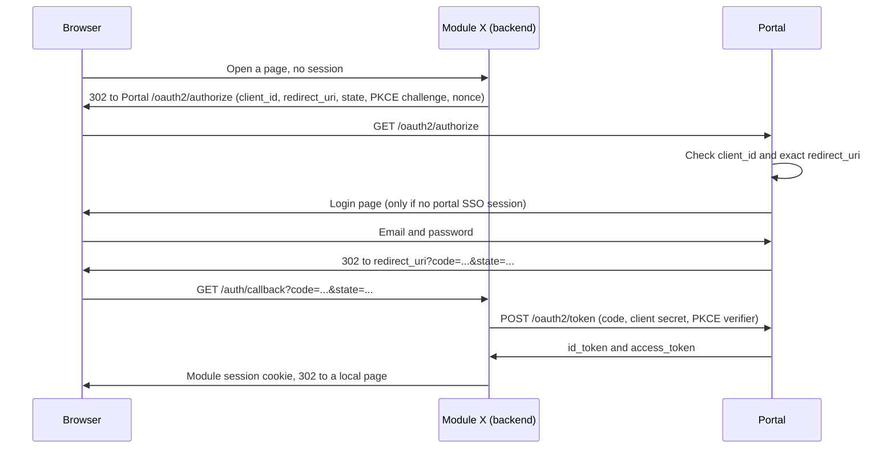

# Single sign-on through the portal

The other UniCloud modules log users in through the portal. A user signs in once, at the portal, and every module trusts that sign-in.

The portal is a standard **OpenID Connect** provider. It uses the **OAuth 2.0 authorization code flow with PKCE**. Every module can use an existing OIDC client library in its own language. Nothing here is specific to UniCloud except the user claims.

**Module teams:** sections 1 to 11 are for you. Start with [Testing a module against staging](#testing-a-module-against-staging) to log in from your own machine today. Sections 12 to 14 are for the portal team.

## Contents

1. [The rules in short](#the-rules-in-short)
2. [Callback URLs per environment](#callback-urls-per-environment)
3. [The flow](#the-flow)
4. [Endpoints](#endpoints)
5. [What a module must build](#what-a-module-must-build)
6. [User claims](#user-claims)
7. [Logout](#logout)
8. [The directory API](#the-directory-api)
9. [Testing a module against staging](#testing-a-module-against-staging)
10. [Going to production](#going-to-production)
11. [Troubleshooting](#troubleshooting)
12. [Registering a module (portal admins)](#registering-a-module-portal-admins)
13. [How the portal does it](#how-the-portal-does-it)
14. [Not done yet](#not-done-yet)

## The rules in short

- A module sends the browser to the portal's `/oauth2/authorize` with a `redirect_uri` (the "callback"). The portal sends the user back to it after login.
- In production every callback URL is registered in advance, on a host the portal allows. The portal refuses any other URL and does not redirect to it. A matching host or prefix is not enough: the whole URL must match, character for character. Staging accepts any callback (see [Callback URLs per environment](#callback-urls-per-environment)).
- The callback **never** receives user data or a token. It receives a short-lived, single-use `code`.
- The module's backend exchanges that code for the user's identity by calling the portal directly, server to server.

Why: anything put in a redirect URL ends up in browser history, server logs and `Referer` headers. A callback URL that is not checked lets an attacker send a victim to the login page with their own callback and receive the victim's identity.

## Callback URLs per environment

The callbacks are the `redirect_uri` of a login and the `post_logout_redirect_uri` of a logout.

| Environment | Which callbacks work | Set by |
|---|---|---|
| **Production** | Only URLs registered for the module, matched exactly, `https`, on a host listed in [`config/sso-callback-hosts.txt`](../config/sso-callback-hosts.txt) | `APP_ENV=production`, the default |
| **Staging** | Any absolute `http` or `https` URL, registered or not, including `http://localhost` on a developer's machine | `APP_ENV=staging` (set by `render.yaml`) |

**The production host list.** `config/sso-callback-hosts.txt` holds one comma-separated list. An entry is an exact host (`library.tu-sofia.bg`) or every subdomain of a domain (`*.tu-sofia.bg`, which does not include `tu-sofia.bg` itself). Change it with a pull request.
- A module can register in production only once its host is on the list.
- Taking a host off the list switches off the logins and logouts of every module that uses it, at the next deploy, even if the module stays registered.
- In an emergency, the variable `APP_SSO_ALLOWED_CALLBACK_HOSTS` overrides the whole list without a release.
- The list is empty today, because no module is live yet.

Even staging accepts only `http` and `https` URLs. A `javascript:` or relative URL is refused everywhere.

## The flow



If the user already has a portal SSO session, step 4 is skipped: the portal sends the code straight back. The session ends after 30 minutes without use, 8 hours after the user typed the password however busy it is, or when the user logs out of the portal.

## Endpoints

`<portal>` is the portal's public address, for example `https://portal.example`. A library that reads the discovery document needs only that address.

| Endpoint | Purpose |
|---|---|
| `GET /.well-known/openid-configuration` | The discovery document. It lists every endpoint below. |
| `GET /oauth2/authorize` | Starts a login. The browser goes here. |
| `POST /oauth2/token` | Exchanges a code for tokens. The module's backend calls it. |
| `GET /oauth2/jwks` | The public keys that sign the tokens, each with a `kid`. |
| `GET /userinfo` | The user's claims, for a module's access token. |
| `GET /connect/logout` | Ends the portal's SSO session. See [Logout](#logout). |
| `GET /api/v1/directory/...` | Read who is who, with no user present. See [The directory API](#the-directory-api). |

## What a module must build

The modules are server-side apps. Each one is a **confidential client**: it holds a client secret on its server.

### Start the login

Before redirecting to the portal, the module:

1. Makes a random `state`, a random `nonce` and a random PKCE `code_verifier` (43 to 128 characters from `A-Z a-z 0-9 - . _ ~`).
2. Stores all three in the user's session on the module's side.
3. Redirects the browser to:

```
GET <portal>/oauth2/authorize
    ?response_type=code
    &client_id=<client_id>
    &redirect_uri=<a registered callback URL>
    &scope=openid profile email unicloud
    &state=<state>
    &nonce=<nonce>
    &code_challenge=<BASE64URL(SHA256(code_verifier))>
    &code_challenge_method=S256
```

`scope` decides which user claims the module receives (see [User claims](#user-claims)). Ask only for what the module needs. `openid` is always required.

PKCE is required. Without `code_challenge` the portal answers the callback with `error=invalid_request`.

### The callback endpoint

The callback must accept exactly these two forms:

```
GET <registered redirect_uri>?code=<opaque string>&state=<the state the module sent>
GET <registered redirect_uri>?error=<access_denied|invalid_request|invalid_scope|...>&error_description=<text>&state=<the state the module sent>
```

The handler must:

1. Compare `state` with the value stored in the session. If they differ, reject the request. This stops login CSRF, where an attacker logs the victim into the attacker's account.
2. On `error`, show a message. Do not loop back to the portal automatically.
3. On `code`, exchange it as described below.
4. Validate the `id_token` (see below).
5. Create the module's **own** session, as a cookie with `HttpOnly; Secure; SameSite=Lax`.
6. Redirect the user to a **local path** only. If the module remembers a "return to" page, it must be a relative path that the module stored itself. It must never be an absolute URL taken from the query string.

### Exchanging the code

The module's backend makes a normal HTTPS request to the portal. The browser takes no part in it.

```
POST <portal>/oauth2/token
Authorization: Basic base64(<client_id>:<client_secret>)
Content-Type: application/x-www-form-urlencoded

grant_type=authorization_code
&code=<code from the callback>
&redirect_uri=<the same redirect_uri as in the login>
&code_verifier=<the PKCE code_verifier>
```

Response:

```json
{
  "access_token": "<JWT>",
  "id_token": "<JWT>",
  "scope": "openid profile email unicloud",
  "token_type": "Bearer",
  "expires_in": 1799
}
```

There is no refresh token. When the module's own session ends, it sends the user through the login again. If the portal's SSO session is still alive, that takes no password.

The endpoint is public, and that is safe. No single value in the request is enough to get a token:

| Value | What it proves |
|---|---|
| `client_secret` | The caller is the module's server. Only that server has the secret. |
| `code` | A user just logged in for this module. The code is single use and expires after 60 seconds. |
| `redirect_uri` | The code is used where it was issued for. |
| `code_verifier` | The caller is the party that started this login. It must hash to the `code_challenge`. |

An attacker who sees a code, in browser history or a log for example, has neither the secret nor the verifier. They cannot exchange it.

A code is exchanged once. A second exchange fails with `invalid_grant`, and the portal also **revokes the tokens the first exchange gave**, because one of the two callers was not the module. This holds even when two portal replicas receive the same code at the same moment.

Errors follow RFC 6749: `400` with `{"error": "invalid_grant"}` for a bad, used or expired code or verifier, and `401` with `{"error": "invalid_client"}` for a wrong client id or secret.

### Validating the `id_token`

Check all of these. Most OIDC libraries do it for you:

- The RS256 signature checks out against the keys at `/oauth2/jwks`. Cache the keys. Fetch them again when a token has a `kid` you do not know.
- `iss` is the portal's address, exactly as in the discovery document.
- `aud` contains the module's own `client_id`.
- It is an ID token, not an access token: access tokens carry the header `typ: at+jwt`, ID tokens have no `typ`. Never accept one in place of the other.
- `exp` has not passed. Allow a small clock skew, for example 60 seconds.
- `nonce` matches the value stored in the session.

### Rules for every module

- Keep `client_secret` on the server. It never goes into frontend code or into the repo.
- Use PKCE (S256), `state` and `nonce` on every login.
- Exchange the code from the backend only, over HTTPS.
- Never pass portal tokens to browser JavaScript. Never put them in URLs or logs.
- Use your own session for your own app. Use the `role` and `permissions` claims as input to your own authorization checks, not as a replacement for them.
- Treat a role or permission you do not know as no access (see [User claims](#user-claims)).
- A token from a user login works only for that module and for `/userinfo`. A client-credentials token works only for the directory API.

## User claims

Every module may ask for the four user scopes. Each group of claims comes only with its scope, so a module gets just what it asked for. The list will shrink once each team says what it needs. The `directory` scope is different: it is granted per module (see [The directory API](#the-directory-api)).

The claims are in the `id_token`, and `/userinfo` returns the same ones for the module's access token. They are read from the database at the moment the token is issued.

| Claim | Scope | Example | Notes |
|---|---|---|---|
| `sub` | `openid` | `"4"` | The portal's user id. Stable. Use it as the key, not the email. |
| `auth_time` | `openid` | `1795031651` | When the user typed the password |
| `email` | `email` | `"student1@student.tu-sofia.bg"` | |
| `given_name` | `profile` | `"Александър"` | |
| `family_name` | `profile` | `"Стоянов"` | |
| `name` | `profile` | `"Александър Стоянов"` | |
| `role` | `unicloud` | `"STUDENT"` | Today one of `STUDENT`, `TEACHER`, `DEAN`, `INSPECTOR`, `ADMIN`. More may come |
| `permissions` | `unicloud` | `["STUDENT_PROFILE_READ_OWN", "COURSE_OFFERING_READ", "ENROLLMENT_REQUEST_CREATE"]` | The portal's permission names, in a fixed order. More may come |
| `faculty` | `unicloud` | `{"code": "FCST", "name": "Факултет по компютърни системи и технологии"}` | For students (through their specialty), teachers, deans and inspectors. Admins have none |
| `student` | `unicloud` | `{"faculty_number": "121219001", "specialty": "Компютърни науки", "study_year": 2, "status": "ACTIVE"}` | Only for students. `status` is `ACTIVE`, `INTERRUPTED` or `GRADUATED` |

**Unknown values mean no access.** The portal adds roles, permissions and claims over time. It never renames or removes one. Your code must accept a `role` or a permission it does not know, and grant nothing for it. Do not fail the login, and do not map it to a default role.

**Who is who.** A teacher is `TEACHER`; the portal has no separate "professor". A dean (`DEAN`) leads one faculty and by default holds `STUDENT_PROFILE_READ_FACULTY` (the students of that faculty) and `COURSE_OFFERING_READ`. The shared identifier of a course across UniCloud is its **course code**, for example `MATH1`.

The ID token travels again in the logout URL (`id_token_hint`), where proxies may log it. That is one more reason to ask only for the scopes you use.

A user who is disabled or deleted gets no new tokens: the exchange fails with `invalid_grant`.

## Logout

**Module only.** The module ends its own session. The user stays logged in at the portal, so the next module login takes no password.

**Everywhere.** The module ends its own session, then redirects the browser to:

```
GET <portal>/connect/logout
    ?id_token_hint=<the id_token the module received at login>
    &client_id=<client_id>
    &post_logout_redirect_uri=<a registered logout URL>
    &state=<optional>
```

The portal ends its SSO session and redirects to `post_logout_redirect_uri?state=...`. The logout URL must be registered, like the callback. The portal keeps what it needs for this for 24 hours after the login.

Logging out of the portal itself (the "Изход" button) also ends the SSO session: the portal and single sign-on share one session per browser.

Not done: single logout, where logging out of one module also ends the user's session in every other module.

## The directory API

Some data is needed with no user present: every student in a course, every course of a faculty. For that a module calls the directory API from its backend. It is read-only.

**Get a token.** The module must hold the `directory` grant (tick it when you register on staging; ask the portal team in production). Then:

```
POST <portal>/oauth2/token
Authorization: Basic base64(<client_id>:<client_secret>)
Content-Type: application/x-www-form-urlencoded

grant_type=client_credentials&scope=directory
```

The answer is `{"access_token", "scope": "directory", "token_type": "Bearer", "expires_in": 1800}`. Cache it until it expires. A module without the grant gets 400 `invalid_scope`.

**Call it** with `Authorization: Bearer <token>`. Without a valid token every route answers 401.

| Request | Answer |
|---|---|
| `GET /api/v1/directory/users/{sub}` | `{sub, role, given_name, family_name, name, email, faculty, student}`, the same shapes as the claims. 404 for an unknown or disabled user |
| `GET /api/v1/directory/users/{sub}/enrollments` | The student's current courses: `[{id, code, title, semester}]`. 404 if the user is not a student |
| `GET /api/v1/directory/users/{sub}/offerings` | The courses a teacher teaches: `[{id, code, title, semester}]`. 404 if the user is not a teacher |
| `GET /api/v1/directory/offerings/{id}/students` | The students enrolled in a course: `[{sub, name, faculty_number}]` |
| `GET /api/v1/directory/faculties/{code}/offerings?semester=2026-27-W` | A faculty's courses: `[{id, code, title, semester, teacher_sub}]` |
| `GET /api/v1/directory/faculties/{code}/students` | A faculty's students: `[{sub, name, faculty_number, specialty, study_year, status}]` |

`code` is the course code, the identifier to share with other modules. `id` names one course in one semester. The two faculty lists return at most 200 items. When there are more, the answer has a `Link: <...?page=2>; rel="next"` header.

Grades and materials are not here: they belong to Team 3 and Team 2.

## Testing a module against staging

A module team tests its own changes on its own machine against the portal's **staging** deployment. No local copy of the portal is needed.

**Staging address:** `https://unicloud-portal-staging-tszc.onrender.com`. It runs the new Rust portal: register your module and create your test users again, because the old registrations and users are not carried over.

Staging has two things production does not:

- **Any callback URL works**, so the portal can send the browser back to `http://localhost:3000/...` on a developer's machine. The module's backend calls staging's `/oauth2/token` over the internet as usual.
- **Staging tools**, with no login needed: a page at `https://unicloud-portal-staging-tszc.onrender.com/staging` and the same actions as an API. With them a team makes its own test users, with exactly the role and permissions it needs, and registers its module (with the `directory` grant if it needs it).

**Step by step:**

1. Open `https://unicloud-portal-staging-tszc.onrender.com/staging`.
2. Under **Register your module for single sign-on**, pick a client id (for example `module-x`) and register. Tick the directory box if your backend needs [the directory API](#the-directory-api). Copy the secret: it is shown once. Register again under a new id if it is lost.
3. Under **Create a test user**, pick a role, and a faculty for a teacher, dean or inspector. The role's default permissions are given; change them in the users table. Add a student record for a student. Choose the password yourself. The user can sign in at once.
4. Point the module's OIDC library at staging:

| Setting | Value |
|---|---|
| Issuer / discovery | `https://unicloud-portal-staging-tszc.onrender.com` (`/.well-known/openid-configuration`) |
| Client id and secret | From step 2 |
| Client authentication | `client_secret_basic` |
| Callback | Anything, for example `http://localhost:3000/auth/callback` |
| Scopes | `openid profile email unicloud` (and `directory` for client credentials) |
| PKCE | `S256` (required) |

5. Log in through the module with the user from step 3. To test other permissions, use **Edit permissions** in the users table, then log in again. Tokens are issued with the permissions of that moment.

Staging's free hosting sleeps after 15 minutes without visitors, so the first request after a pause can take 1 to 3 minutes.

**The API.** The staging tools need no login and exist only on staging:

| Request | What it does |
|---|---|
| `GET /api/v1/staging/roles` | Every permission, and each role's defaults |
| `GET /api/v1/staging/users` | Every user, with role, faculty and permissions (never passwords) |
| `POST /api/v1/staging/users` | Creates a user. Body: `email`, `password` (8 to 72 characters), `firstName`, `lastName`, `role`, `faculty` (a faculty code such as `FCST`, required for `TEACHER`, `DEAN` and `INSPECTOR`), and optionally `permissions` (a list of names: left out means the role's defaults, `[]` means none) and `student` (required for `STUDENT`: `facultyNumber`, `specialty` such as `Компютърни науки`, `studyYear`, `status`) |
| `PUT /api/v1/staging/users/{id}/permissions` | Replaces the user's permissions. Body: `{"permissions": [...]}` |
| `POST /api/v1/staging/sso-clients` | Registers a module. Body: `clientId`, `name`, `redirectUris`, optionally `postLogoutRedirectUris` and `directory` (true for the directory grant). Returns the secret once |

```bash
curl -X POST https://unicloud-portal-staging-tszc.onrender.com/api/v1/staging/users -H 'Content-Type: application/json' -d '{
  "email": "x.teacher@test.tu-sofia.bg", "password": "a-long-password",
  "firstName": "Test", "lastName": "Teacher", "role": "TEACHER", "faculty": "FCST",
  "permissions": ["COURSE_OFFERING_READ", "STUDENT_PROFILE_READ_ANY"]}'
```

**Keep in mind.** Everything on staging is shared: every team sees and can change every user. Use made-up people and passwords. Production has none of this: there the routes do not exist, and callbacks follow the host list.

**Roles and their default permissions.** `GET /api/v1/staging/roles` always has the current list.

| Role | Default permissions |
|---|---|
| `STUDENT` | `STUDENT_PROFILE_READ_OWN`, `COURSE_OFFERING_READ`, `ENROLLMENT_REQUEST_CREATE` |
| `TEACHER` | `COURSE_OFFERING_READ`, `STUDENT_PROFILE_READ_ENROLLED`, `ENROLLMENT_REQUEST_ACCEPT_REJECT` |
| `INSPECTOR` | `STUDENT_CREATE`, `STUDENT_PROFILE_READ_ANY`, `COURSE_CREATE_MODIFY`, `COURSE_OFFERING_READ`, `COURSE_OFFERING_CREATE_MODIFY` |
| `DEAN` | `STUDENT_PROFILE_READ_FACULTY`, `COURSE_OFFERING_READ` |
| `ADMIN` | `STAFF_CREATE` |

On staging any user can have any mix of the eleven permissions, whatever the role. A token carries the permissions the user had when it was issued, so log in again after changing them.

## Going to production

Production is strict. Before your module goes live, send the portal team:

- the client id you want (2 to 63 lower-case letters, digits or dashes, not starting with a dash; `unicloud-api` is reserved),
- whether your backend needs the directory API,
- every callback URL, written out in full, each `https`,
- every URL the user should land on after a logout everywhere, if you use it (see [Logout](#logout)),
- the host names of those URLs, for example `library.tu-sofia.bg`.

The portal team adds your host to production's allowed list (`config/sso-callback-hosts.txt`, released with the portal's next deploy), registers your module, and sends you the client id and secret over a private channel.

| | Staging | Production |
|---|---|---|
| Callback URLs | Any `http` or `https` URL, registered or not | Only the registered URLs, matched exactly, `https`, on an allowed host |
| Who registers your module | You, on the staging page | The portal team |
| Test users | You make them on the staging page | Real accounts only |

Configure each environment separately: the issuer, client id and secret all differ.

## Troubleshooting

| What you see | Likely cause and fix |
|---|---|
| A plain 400 page at the portal, no redirect back | The callback URL is not allowed (production), or the client id is unknown. Check both against your registration |
| The callback gets `error=invalid_request` | PKCE is missing. Send `code_challenge` and `code_challenge_method=S256` |
| The callback gets `error=invalid_scope` | A scope your module may not use. Allowed: `openid profile email unicloud` |
| The token request answers `invalid_client` (401) | Wrong client id or secret, or the secret is not sent with HTTP Basic |
| The token request answers `invalid_grant` (400) | The code expired (60 seconds) or was used already, or `redirect_uri` or `code_verifier` differs from the login |
| Your library rejects the ID token on `iss` | The configured issuer is not exactly the portal's address. Copy it from the discovery document |
| `/userinfo` answers 401 | Send the access token from the code exchange, not the ID token or a client-credentials token. It expires after 30 minutes |
| The directory API answers 401 | Use a token from `grant_type=client_credentials&scope=directory`, not one from a user login. It expires after 30 minutes |
| A user's `role` is a value you do not know | Treat it as no access, and keep the login working. See [User claims](#user-claims) |
| The user lands on the portal's profile page instead of your module | The login took too long and the portal forgot the waiting request. Start the login from your module again |
| A request to staging takes very long, or times out | Staging runs on Render's free plan, which stops the service after 15 minutes without requests. The next request starts it again, and the portal takes 1 to 3 minutes to boot. Until then requests wait, and some time out. That includes your backend's calls to `/oauth2/token`, `/oauth2/jwks` and the discovery document, not just the browser. Open the staging address in a browser first, wait until it answers, then retry. If your OIDC library gives up during the boot, raise its timeout for staging or retry the request |
| Staging no longer knows your module (a plain 400 page) or your test users | Staging's free database is replaced every 30 days, and everything in it is lost: modules, secrets and users. Register your module and create your users again on the staging page |

## Registering a module (portal admins)

A portal admin registers each module once, on the portal page **Модули** (`/admin/modules`):

1. Sign in as an admin and open **Модули**.
2. Fill in the client id, a name, the callback URLs (one per line) and, if used, the logout URLs. Tick the directory box if the module's backend needs [the directory API](#the-directory-api).
3. Press **Регистрирай**. The page shows the client secret **once**. Send it to the module team over a private channel. The portal stores only its SHA-256 hash.

The rules:

- `clientId`: 2 to 63 lower-case letters, digits or dashes, not starting with a dash. `unicloud-api` is reserved. A taken id is refused.
- `name`: 1 to 200 characters.
- Every URL must follow the environment's rule (see [Callback URLs per environment](#callback-urls-per-environment)). In production that means `https` on a listed host. Everywhere: no fragments, user info, `*` or `,`. Each list joined by commas is at most 1000 characters.
- The secret is 32 random bytes, URL-safe base64 without padding: 43 characters.
- Only the `ADMIN` role sees the page. Every registration is logged with the admin's user id.
- Module teams do not need an admin to develop: on staging they register themselves (see [Testing a module against staging](#testing-a-module-against-staging)).

## How the portal does it

For the portal team. The design is in [openspec/changes/rust-rewrite/design.md](../openspec/changes/rust-rewrite/design.md), and the exact wire behaviour is in [sso-wire-contract.md](sso-wire-contract.md).

- **Our own provider.** Rust, axum and `jsonwebtoken`, in `src/oidc/`. No OIDC library was mature enough ([ADR 0001](adr/0001-rust-rewrite-with-hypermedia-ui.md)). `tests/sso_conformance.rs` pins the behaviour in this guide.
- **One session.** The portal UI and single sign-on share one server-side session in the cookie `__Host-UNICLOUD_SSO` (`HttpOnly; Secure; SameSite=Lax`), stored in PostgreSQL so every replica sees it ([ADR 0003](adr/0003-one-cookie-session.md)). It ends after 30 minutes idle, or 8 hours after the password was typed. Every state-changing form carries a CSRF token.
- **Codes.** A code is 32 random bytes. Only its SHA-256 is stored, with the module, callback, PKCE challenge, nonce and scopes. A conditional `UPDATE` redeems it, so exactly one exchange can win across replicas. A second exchange revokes what the first one issued.
- **Callback rule.** `src/oidc/policy.rs`. Production (`APP_ENV=production`) uses the allowlist and `config/sso-callback-hosts.txt` (or `APP_SSO_ALLOWED_CALLBACK_HOSTS`). Staging and development accept any absolute `http` or `https` URL. The rule runs at registration, at every authorize and at every logout.
- **Staging tools.** `src/staging.rs`. The routes exist only when `APP_ENV` is not `production`. In production they answer 404.
- **Keys.** One RSA key from `APP_SIGNING_KEY_PEM`. The public key is published with its RFC 7638 thumbprint as `kid`.
- **Issuer.** `APP_SSO_ISSUER`, else Render's `RENDER_EXTERNAL_URL`, else the request's own scheme and host.
- **Retention.** An hourly job deletes logins older than a day, expired codes and expired client tokens.
- **Directory.** `src/directory.rs`. Client-credentials tokens have `aud=unicloud-directory`, are recorded by `jti`, and stop working when the module loses the grant.

## Not done yet

- **Changing and deleting modules, and rotating a secret.** Today an admin can only register. Until there is a page for it, a secret is replaced by deleting the row in `oauth_clients` and registering again.
- **Signed client authentication (`private_key_jwt`).** Stronger than a shared secret, but more work for the module teams.
- **Rate limiting per IP.** Sign-in locks an email after 10 failures for 15 minutes, and expired sessions are deleted hourly. There is no limit per IP, and none on attempts at `/oauth2/token` (secrets are 256 random bits, so guessing one is not practical). Best done at the ingress.
- **Single logout** across modules (see [Logout](#logout)).
- **Key rotation.** Tokens already carry a `kid`, so a second key can be published next to the first when the time comes.
