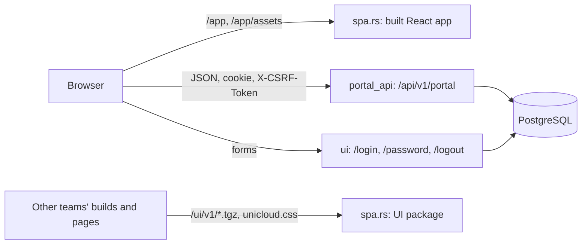

# Design: React UI with a JSON API

Status: built on branch `rust-rewrite` (2026-11-21). Decision: [ADR 0004](../../../docs/adr/0004-react-ui-with-a-json-api.md).

## Shape



```text
src/portal_api/   mod.rs (routes, ApiUser, ApiError, ApiBody, nav_links), me, catalog, teach, inspect, admin
src/spa.rs        `/` redirect, `/app` (index.html fallback), `/ui/v1` (CORS, cached)
web/packages/ui   @unicloud/ui: components, uc- stylesheet, Vite library build, Vitest
web/apps/portal   the app: React Router (basename /app), TanStack Query, typed client
```

## The API
- Every handler takes `ApiUser`. Without a session it answers 401 `unauthenticated`; before the first password change it answers 403 `password_change_required`. It never redirects.
- Every handler checks a permission, with the same rules as the old pages. A profile the user may not see is 404, as before.
- Errors are `PortalError {error, message}`, with Bulgarian messages the app shows as they are. A malformed JSON body is `invalid`, not axum's plain-text answer.
- A refused enrollment is 409 with the same `EnrollResult` body as a success, so the app reads one shape.
- The module registration answer carries `Cache-Control: no-store` (the secret is shown once). Errors carry it too.
- CSRF: `require_csrf_api` accepts only the `X-CSRF-Token` header and answers JSON. The token comes from `GET /api/v1/portal/me`.

## Hosting
- `/app/*` serves the built files. Unknown paths get `index.html`, so the app's router decides. `/app/assets/*` never falls back: a missing asset is 404.
- `index.html` is `no-cache`; hashed assets are cached for a year as immutable.
- `/ui/v1/*` sends `Access-Control-Allow-Origin: *` and `Cross-Origin-Resource-Policy: cross-origin`, cached for an hour. A published version never changes; a new version gets a new file name.
- The CSP stays `script-src 'self'`. The Vite build has no inline script.

## The app
- On a 401 the app does a full page load to `/login?next=/app/<path>`. On `password_change_required` it loads `/password`.
- The navigation comes from `me.nav`. Paths are relative to `/app`.
- The types in `src/api/schema.d.ts` are generated by `npm run gen:api`. CI fails if they differ from `api/openapi.json`.

## Sign-in return path
`next` is used only if it starts with `/app/`, has no `//` and no backslash, and is at most 512 characters. Otherwise sign-in goes to `/app/`. A waiting SSO login still wins over `next`.

## Known gaps
- The app's bundle is about 93 KB gzipped (React, React Router, TanStack Query and the app). Code splitting per role is not done.
- `@unicloud/ui` is served from the portal, not from an npm registry. A team that needs a registry can mirror the tarball.
- The contract mixes cases in one place: module registration uses camelCase (it matches the staging API and the Java contract), the rest of the portal API uses snake_case.
