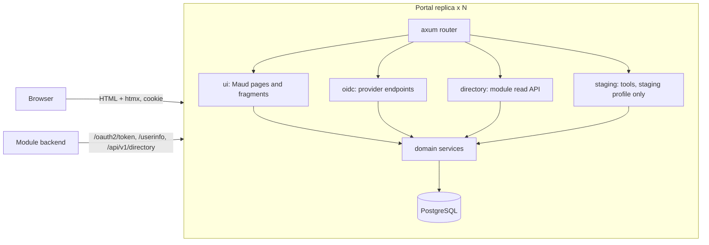
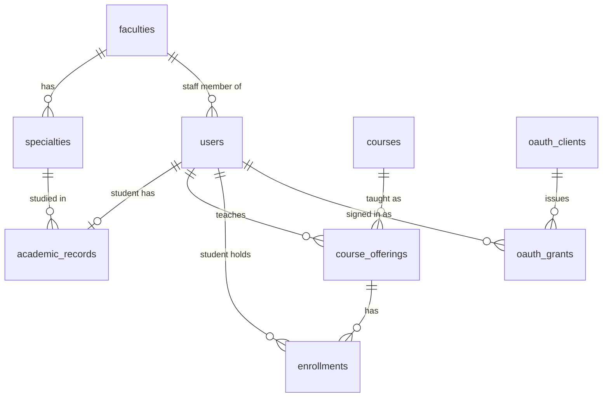

# Design: UniCloud Portal in Rust

Status: built on branch `rust-rewrite` (2026-11-20). Requirements: [docs/prd.md](../../../docs/prd.md). Decisions: [ADR 0001](../../../docs/adr/0001-rust-rewrite-with-hypermedia-ui.md), [0002](../../../docs/adr/0002-grow-the-sso-contract.md), [0003](../../../docs/adr/0003-one-cookie-session.md). Wire contract to keep: [docs/sso-wire-contract.md](../../../docs/sso-wire-contract.md).

## Context
The Java portal works and has a published SSO contract (`docs/sso.md`). Module teams already code against it. The rebuild must replace the internals without the modules noticing, except that they must register again. It must also add deans, faculties and a directory API, run on free plans, and survive the 08:00 rush on 2 or more replicas.

## Goals and non-goals
- Goals: one stateless Rust binary. Any replica answers any request. All state is in PostgreSQL. Server-rendered Bulgarian UI. A wire-compatible OIDC provider.
- Non-goals: grades, materials, email, self sign-up, single logout, refresh tokens, key rotation, migrating Java data.

## Architecture



The crate layout is one binary crate with modules by feature, not by layer:

```text
src/
  main.rs            config, tracing, pool, migrations, router, graceful shutdown
  config.rs          environment variables (table below)
  web/               shared extractors: CurrentUser, RequirePermission, Csrf, HxRequest
  ui/components/     Maud components: layout, nav, table, form fields, flash, pager
  accounts/          users, passwords, first-password change, sign-in, sign-out
  academic/          faculties, specialties, academic records
  catalog/           courses and course offerings
  enrollment/        enroll, reject, cancel, seat accounting
  access/            Role, Permission (bit positions), role defaults, checks
  oidc/              discovery, jwks, authorize, token, userinfo, logout, clients, keys, callback policy
  directory/         /api/v1/directory handlers
  staging/           /staging page and /api/v1/staging routes
  ops/               /health, /, X-Served-By, cleanup jobs
migrations/          sqlx migrations (PostgreSQL only)
assets/              htmx.min.js (2.0.x, vendored), app.css
tests/               black-box suites (sso_conformance, directory, enrollment_race, staging)
```

## Data model



| Table | Key columns | Notes |
|---|---|---|
| `faculties` | `code` (PK, for example `FCST`), `name` | Seeded |
| `specialties` | `id`, `faculty_code`, `name` | Seeded |
| `users` | `id` (bigint, the OIDC `sub` as a string), `email` (unique, lower case), `password_hash` (Argon2id), `first_name`, `last_name`, `role`, `permissions_mask` (bigint), `faculty_code` (null for admins and students), `must_change_password`, `enabled`, `created_at` | A student's faculty comes from the specialty |
| `academic_records` | `user_id` (PK), `faculty_number` (unique), `specialty_id`, `study_year` (1 to 6), `status` (`ACTIVE`, `INTERRUPTED`, `GRADUATED`) | |
| `courses` | `code` (unique, the shared course id), `title`, `ects_credits`, `faculty_code` | |
| `course_offerings` | `id`, `course_code`, `semester` (`2026-27-W`), `teacher_id`, `capacity`, `enrolled_count`, `is_open` | `CHECK (enrolled_count BETWEEN 0 AND capacity)` |
| `enrollments` | `id`, `student_id`, `offering_id`, `status` (`ENROLLED`, `CANCELLED`, `REJECTED`), `created_at`, `decided_by` | Unique `(student_id, offering_id)` |
| `oauth_clients` | `client_id` (PK), `name`, `secret_hash` (SHA-256: the secret has 256 random bits, so a slow hash adds nothing), `redirect_uris` (text[]), `post_logout_redirect_uris` (text[]), `directory_access`, `registered_by`, `created_at` | |
| `oauth_codes` | `code_hash` (PK), `grant_id`, `redirect_uri`, `nonce`, `code_challenge`, `auth_time`, `expires_at`, `redeemed_at` | 60 s |
| `oauth_grants` | `id`, `client_id`, `user_id`, `scope`, `session_id` (the `sid`), `access_jti`, `id_token_jti`, `revoked`, `created_at` | Used by `/userinfo`, logout `id_token_hint` and replay revocation. Kept for 24 hours |
| `oauth_client_tokens` | `jti`, `client_id`, `expires_at` | Client-credentials tokens for the directory |
| `tower_sessions.session` | managed by tower-sessions-sqlx-store, in its own schema | The `__Host-UNICLOUD_SSO` cookie |

Permissions stay a bitmask in the database and a list of names on the wire. Bits 0 to 9 are unchanged. Bit 10 is `STUDENT_PROFILE_READ_FACULTY`.

| Role | Default permissions |
|---|---|
| `STUDENT` | `STUDENT_PROFILE_READ_OWN`, `COURSE_OFFERING_READ`, `ENROLLMENT_REQUEST_CREATE` |
| `TEACHER` | `COURSE_OFFERING_READ`, `STUDENT_PROFILE_READ_ENROLLED`, `ENROLLMENT_REQUEST_ACCEPT_REJECT` |
| `DEAN` | `STUDENT_PROFILE_READ_FACULTY`, `COURSE_OFFERING_READ` |
| `INSPECTOR` | `STUDENT_CREATE`, `STUDENT_PROFILE_READ_ANY`, `COURSE_CREATE_MODIFY`, `COURSE_OFFERING_READ`, `COURSE_OFFERING_CREATE_MODIFY` |
| `ADMIN` | `STAFF_CREATE` |

## Key flows

### Sign-in and the session
1. `GET /login` renders the form. `POST /login` checks the email and the Argon2id hash. On success it cycles the session id, stores `user_id`, `login_at` and a CSRF token, and sets `__Host-UNICLOUD_SSO` (`HttpOnly; Secure; SameSite=Lax; Path=/`).
2. If `must_change_password` is set, every page except `/password` and `/logout` redirects to `/password` until the user sets a new one.
3. The session ends after 30 minutes idle, 8 hours after `login_at`, or at `POST /logout`. Logout also ends single sign-on.
4. If a pending `/oauth2/authorize` query is stored in the session, a successful sign-in redirects back to it. This replaces the Java `sso-session` bridge.

### Authorization code flow
1. `GET /oauth2/authorize` validates in this order. Unknown `client_id`, or a callback not allowed by the policy: a plain 400 page, no redirect. Then `response_type=code`, scopes within the client's set, `code_challenge` present with `S256`: on failure, a redirect to the callback with `error` and `state`.
2. With no session, the query is stored in the session and the browser goes to `/login?sso=1`.
3. With a session, a random 32-byte code is created and only its SHA-256 is stored, with a 60 s expiry. Redirect to `redirect_uri?code=...&state=...`.
4. `POST /oauth2/token`: HTTP Basic client auth (constant-time SHA-256 check of the secret), then a conditional `UPDATE oauth_codes SET redeemed_at=now() WHERE code_hash=$1 AND redeemed_at IS NULL AND expires_at>now()`. If no row changes and the code exists, the grant created by the first exchange is revoked and the answer is `invalid_grant`. This keeps the Java guarantee across replicas without locks.
5. The `redirect_uri` and the PKCE verifier are checked. The user must still be enabled. Then the access token and ID token are signed, a grant row is written, and the JSON response is returned.

### client_credentials
`POST /oauth2/token` with `grant_type=client_credentials` and `scope=directory`, for clients that hold the `directory` scope. It returns an access token with `sub=<client_id>`, `aud=unicloud-directory` and `scope=directory`, valid 30 minutes. `/api/v1/directory/**` accepts only such tokens. `/userinfo` refuses them.

### Enrollment without overselling
One transaction:
1. `UPDATE course_offerings SET enrolled_count = enrolled_count + 1 WHERE id=$1 AND is_open AND enrolled_count < capacity RETURNING ...`. Zero rows means the offering is full or closed.
2. Insert the enrollment, or re-activate a `CANCELLED` one. The unique key stops a double request.
3. A rejection or cancellation decrements `enrolled_count` in the same transaction as the status change.

The CHECK constraint is the last line of defence. The `enrollment_race` test fires 200 concurrent requests at an offering with 10 places.

## Directory API
`Authorization: Bearer <client_credentials token>`. JSON, `snake_case`, same claim shapes as the ID token. Lists are paginated with `?limit=` (default 100, maximum 500) and `?after=`.

| Endpoint | Returns |
|---|---|
| `GET /api/v1/directory/users/{sub}` | `sub`, `role`, `name`, `given_name`, `family_name`, `email`, `faculty`, `student` (if any) |
| `GET /api/v1/directory/users/{sub}/enrollments` | the student's active enrollments as offerings `{id, code, title, semester}` |
| `GET /api/v1/directory/users/{sub}/offerings` | the teacher's offerings |
| `GET /api/v1/directory/offerings/{id}/students` | the students enrolled in an offering |
| `GET /api/v1/directory/faculties/{code}/offerings` | the faculty's offerings for a semester (`?semester=`, default current) |
| `GET /api/v1/directory/faculties/{code}/students` | the faculty's students |

## UI
- Maud functions are the components. `layout(title, user, body)` wraps full pages. An htmx request (`HX-Request: true`) gets only the fragment. The same handler serves both.
- Pages: `/login`, `/password`, `/` (role home), `/profile`, `/offerings` (search and enroll in place), `/my/enrollments`, `/teach` (teacher: offerings, students, reject), `/faculty` (dean), `/admin/users`, `/admin/modules` (module registration, secret shown once), `/inspect/students`, `/inspect/courses`, `/staging` (staging only).
- The navigation shows only what the user's permissions allow. The server checks again on every request.
- CSRF: a session token in a `<meta>` tag, sent by htmx as `X-CSRF-Token` (configured once in the layout), and as a hidden field in plain forms.
- Without JavaScript every page still works as plain forms and links.

## Configuration

| Variable | Meaning |
|---|---|
| `DATABASE_URL` | `postgres://...` |
| `APP_ENV` | `production` or `staging`. `staging` turns on the staging tools and callback policy `any` |
| `APP_SSO_ISSUER` | The public `https` origin, used as `iss`. Falls back to Render's `RENDER_EXTERNAL_URL`, then to the request |
| `APP_SIGNING_KEY_PEM` | The RSA private key (PKCS#8 PEM). The public key and `kid` are derived from it |
| `APP_SSO_ALLOWED_CALLBACK_HOSTS` | Comma-separated host list for production. The default comes from `config/sso-callback-hosts.txt`, compiled in |
| `APP_DB_SCHEMA` | PostgreSQL schema for the tables. Staging uses `portal`, next to the Java tables it leaves alone |
| `APP_DEMO_PASSWORD`, `APP_BOOTSTRAP_ADMIN_EMAIL`, `APP_BOOTSTRAP_ADMIN_PASSWORD` | Demo data (not in production) and the first admin |
| `APP_DB_POOL_MAX` | Default 10 (5 on Render's free plan) |
| `GIT_SHA`, `REPLICA_NAME` | `/health` and `X-Served-By` |

## Deployment
- **Docker:** a cargo-chef planner, a dependency cook layer and a build layer on `rust:1-slim-bookworm`, then `debian:bookworm-slim` with the binary, assets and CA certificates, as user `1000:1000`. Queries are checked at run time by the tests, so the build needs no database and no `.sqlx` data. The image is about 144 MB.
- **Start-up:** schema creation, migrations and the session table run under one PostgreSQL advisory lock, so replicas that start together do not race.
- **Staging:** `render.yaml` keeps the service and database names, so the address and issuer stay the same. The environment variables change to the table above. The Blueprint syncs on push to the fork's `main`. `APP_SIGNING_KEY_PEM` must be set once on the service's Environment page.
- **Production:** Azure Container Apps, 2 to 10 replicas, an HTTP concurrency scale rule, and Azure PostgreSQL Flexible Server B1ms. `infra/setup-azure.sh` and the `deploy` job move from MySQL to PostgreSQL. Deploys need reviewer approval, as today.
- **CI:** `cargo fmt --check`, `cargo clippy -D warnings`, then `cargo test` against a PostgreSQL 17 service, then the Docker build. The MySQL job is deleted. The Azure `deploy` job runs only in the team repository, which holds the Azure secrets.

## Testing
- Unit: the RFC 7638 thumbprint against RFC 7638 section 3.1, the PKCE S256 check, callback policy matching (the cases from `SsoCallbackPolicyTests`), the permission bitmask.
- Black-box suites run the real router on a random port against PostgreSQL through `reqwest`, with one cookie and no redirect following:
  - `tests/sso_conformance.rs`: discovery, JWKS, the full login, claims by scope, plain-400 rules, errors sent to the callback, token errors, code replay, disabled users, logout, the directory API.
  - `tests/portal.rs`: staging API shapes, staging absent in production, sign-in, CSRF, forced password change, permissions per page, the enrollment race (40 students, 10 places), health.
- Golden recording: before cutover, record the Java staging's discovery document, JWKS shape, token response, decoded tokens and error bodies. The Rust suite asserts the same shapes. Differences are either fixed or written into `docs/sso.md`.
- Load: `loadtest/spike.js`, updated to the new routes, against production.

## Cutover
1. Build and test on `rust-rewrite`. Record the Java staging.
2. Merge to the fork's `main`. The Blueprint redeploys staging with a fresh database.
3. Tell module teams to register again and to treat unknown roles as no access.
4. Propose the change to the team repo (`rata5/unicloud-portal`) as a pull request. Production moves to a fresh PostgreSQL, with no data copied from MySQL, only with the team's agreement and a reviewer's approval.

## Security review (2026-11-20)

An independent review of `src/oidc/`, `src/web/`, `src/accounts/`, the directory and the staging tools found no critical or high issues. Fixed:
- Production refuses to start without a fixed `https` issuer; the deploy derives it from the Container Apps domain.
- Sign-in: an unknown email costs the same Argon2 work as a real one; 10 failures lock an email for 15 minutes (per replica); Argon2 runs at most 4 at a time.
- Expired sessions are deleted hourly.
- `/connect/logout` without a valid `id_token_hint` asks the user to confirm with a CSRF-protected form.
- Logout revokes the module logins of that session; a password change revokes all of the user's logins and must use a new password.
- Directory paging is bounded; the `semester` in `Link` is encoded.
- `APP_INSECURE_COOKIE` is ignored in production.
- Security headers on every response (CSP without inline script, `frame-ancestors 'none'`, `nosniff`, `Referrer-Policy`); the module-secret page is `no-store`.
- Access tokens carry `typ: at+jwt` (RFC 9068).
- Client ids `unicloud-*` and all-digit ids are reserved.
- Only an admin can create an admin.
- Enrollment accepts only offerings of the current semester.

Open: whether inspectors are limited to their own faculty (the specs do not say), a per-IP rate limit at the ingress, and `cargo audit` in CI.

## Risks and trade-offs
- A hand-built provider means we own its security. The conformance suite and a short focused review of `oidc/` before release offset that.
- The 30-day staging database means repeated re-registration. Seed data keeps faculties, specialties and sample courses.
- One staging instance is not highly available. Staging is not where the uptime promise applies.
